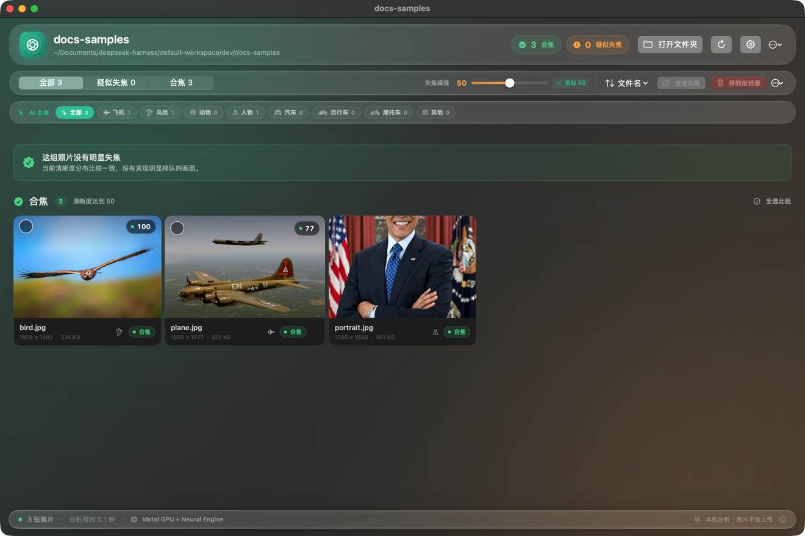
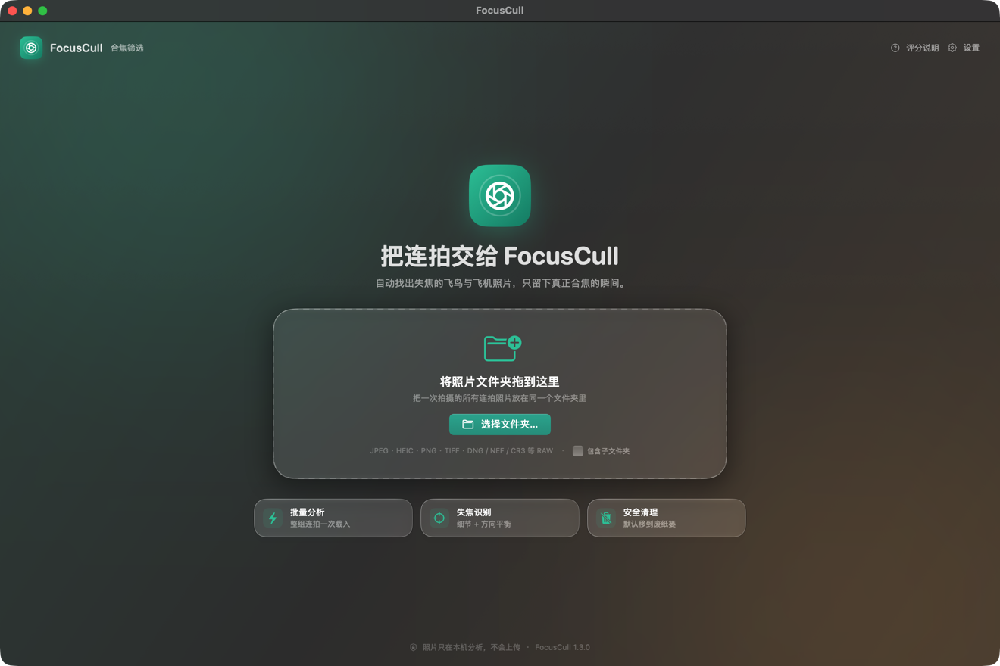
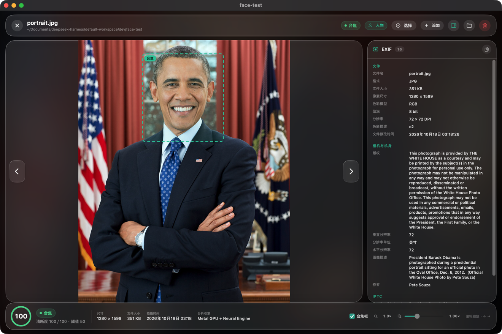
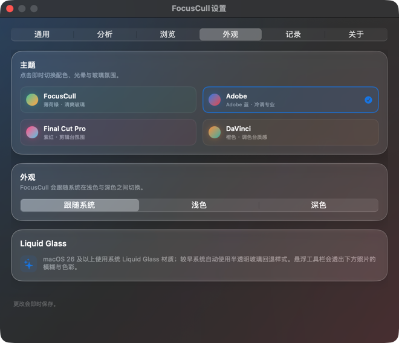
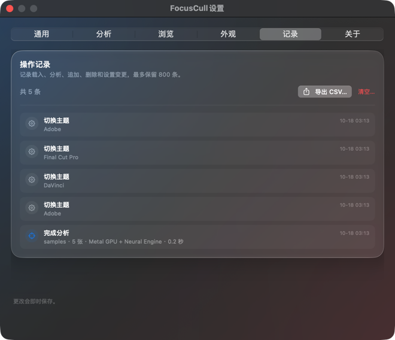
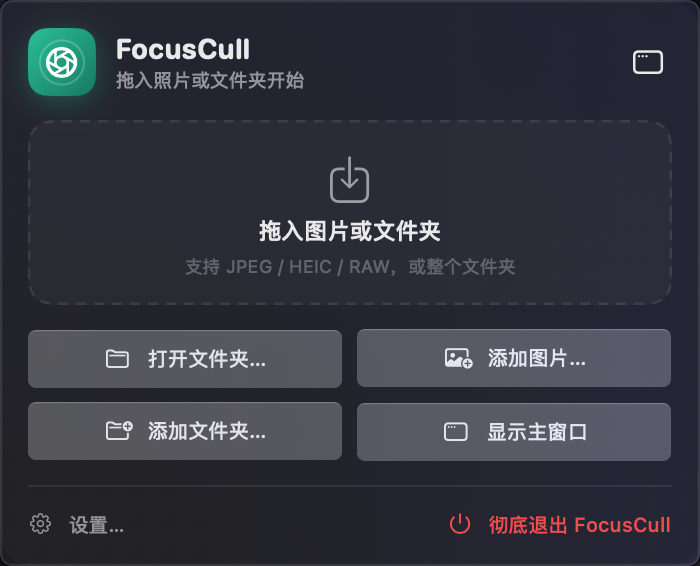
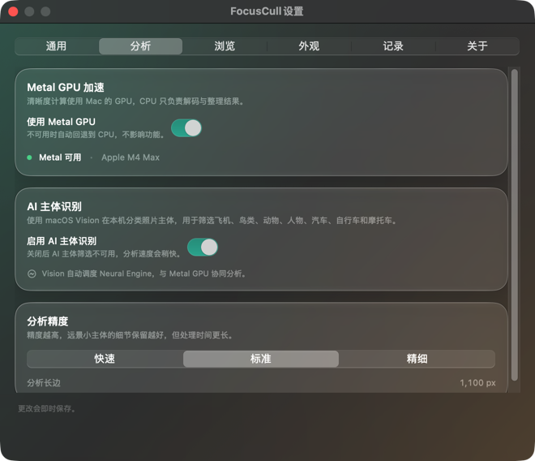

# FocusCull · 合焦筛选

FocusCull 是一个原生 macOS 连拍照片初筛工具，专为**生态摄影、航空摄影、体育摄影、汽车/摩托车追焦**这类“一次快门几百张、回家选片几小时”的拍摄场景而做。

把一次拍摄的整个文件夹拖进来，它会自动分析每张照片的清晰度，把疑似失焦的照片单独分组，并用 AI 标出主体，方便你快速复核、勾选并清理废片。照片只在本机处理，不需要联网，也不会上传。

> **连拍一千张，只想留下真正合焦的那几张。**  
> FocusCull 把清晰度地图交给 **Metal GPU**，把主体理解交给 **Apple Neural Engine**，让 M 芯片在你的 Mac 上完成一次真正的本地筛选。


[**下载 FocusCull 1.4.1**](dist/FocusCull-1.4.1-macOS.zip) · [使用说明](使用说明.md) · [更新日志](CHANGELOG.md) · [MIT License](LICENSE)

开发者：**Lee** · 开发工具：**DeepSeek**



## 为 Apple Silicon 而生

这不是一个把模糊检测跑在浏览器里的工具。FocusCull 是原生 Swift / SwiftUI 应用，把 Apple Silicon 的两条计算链路都用上了：

- **Metal GPU 重建清晰度地图**  
  1100px 灰度图、分离式模糊、水平/垂直方向 Laplacian、重叠分块、局部能量排序，全部在 Metal Compute 中完成。统一内存让解码后的图像不必在 CPU / GPU 之间来回拷贝。
- **Neural Engine 理解画面主体**  
  Vision 自动调度 Apple Neural Engine 与 GPU，完成图像分类、人脸、人体、动物和显著物体检测。人物照片优先锁定人脸，飞机/鸟类/汽车等保留 Metal 合焦区域。
- **两条链路协同**  
  Metal 告诉你「哪里最清晰」，Neural Engine 告诉你「哪里是主体」。两者结合后，合焦框才真正落在你想看的地方，而不是背景的高频纹理上。
- **完全本地**  
  没有云端、没有上传、没有账号。照片只在本机内存和磁盘中处理。

在 M4 Max 上，100 张样张的完整分析约 **1.82 秒**（含解码）。Metal 不可用时自动回退 CPU，Intel Mac 也能运行。

## 适合谁：连拍之后，真正的战场在选片

> 摄影圈有句话：**连拍一时爽，选片火葬场。**  
> 拍的时候怕错过，按快门不心疼；回家导入电脑，看到文件夹里躺着 800 张、2000 张甚至 5000 张照片，才是折磨的开始。

FocusCull 不是又一个相册，也不是修图软件。它只做第一道初筛：**先把明显失焦、不够锐、没必要放大看的照片挑出来**，把“导入电脑后第一轮筛选”的重复劳动交给机器，把最终判断留给你。

活动、婚礼、宠物等所有需要从连拍里挑片的场景，同样适用。

### 生态 / 鸟类摄影

- 连拍速度高，一次快门就是几百张；鸟起飞、捕食、飞版、呆版，动作几乎一模一样。
- 最怕“翅膀尖是清楚的，鸟眼是软的”；背景的树枝、芦苇、水波、羽毛纹理，常常比主体还锐。
- 回家要在 100% 放大下逐张看眼睛、看羽毛、看焦点有没有跑到背景。
- 旅行或野外拍摄，存储卡和硬盘都紧张，废片却占着空间。

FocusCull 会按整批照片的相对清晰度打分，把疑似失焦单独分组；双击打开大图，滚轮放大，勾选「合焦框」直接看算法认为最清晰的区域。人物/骑手的人脸优先；动物则由动物检测补充。

### 航空摄影

- 起飞、降落、通场、编队、特技，一架飞机就是几十张连拍。
- 远小、热浪、逆光、追焦，焦点可能落在机头、座舱、机翼或背景；肉眼在缩略图上根本看不出差别。
- 一次航展或机场半天，回来就是几千张，选片窗口只有一两个晚上。

先用「疑似失焦」过滤掉第一轮，再用 AI 主体筛选只看飞机；大图里放大确认机头/座舱，确认后再清理。把“找片”变成“确认片”。

### 体育摄影

- 30 张/秒甚至更高，一场比赛几千张；同一个动作有十几张几乎一样的连拍。
- 要在一堆相似帧里找“决定性瞬间”，还要确认脸、眼睛、号码布、球是否合焦。
- 交稿时间紧，没时间从第一张开始逐张放大。

FocusCull 的方向平衡分数对运动模糊更敏感；人物照片优先用人脸框，先看脸和眼睛，再看动作。AI 主体筛选可以快速切到「人物」，把观众席、场地、器材先放一边。

### 汽车 / 摩托车追焦

- Rolling shot、弯道、直线加速、追焦摇拍，一次就是几十张。
- 车身要实、背景要拉丝；轮毂、地面、护栏的高频细节很容易“抢焦”。
- 骑手头盔、脸部、车标是否清楚，往往决定这张能不能用。
- 连拍里车身清晰度差一点点，放在社交媒体上就是“糊了”。

FocusCull 的方向性清晰度会区分“整体软”和“单向运动模糊”；大图合焦框会优先看人脸/人体，再结合 Metal 计算的清晰区域。AI 主体筛选支持汽车、自行车、摩托车，追焦片可以按题材快速分组。

### 共同痛点

1. **导入慢、预览慢、放大更慢**：普通看图软件一张张点开，100% 放大看焦点，几百张就耗尽耐心。
2. **缩略图看不出焦点**：鸟眼、机头、运动员的脸、骑手头盔，在缩略图上都差不多。
3. **“清晰”不等于“合焦”**：背景比主体锐、边缘比中心锐，普通锐度评分很容易误判。
4. **重复动作太多**：同一秒的连拍有十几张，真正能用的只有一两张。
5. **云端工具不放心**：客户素材、未发布赛事、野外拍摄，不想上传到别人的服务器。
6. **订阅制和重型软件**：为了一个“选片”动作装一整套工作流，学习成本高。

### FocusCull 的初筛流程

1. 把一次拍摄的文件夹拖进来，或按 `⌘O`。
2. Metal GPU 逐张计算清晰度，Neural Engine 同步识别主体/人脸。
3. 先看「疑似失焦」分组，再用 AI 主体筛选缩小范围。
4. 双击大图、滚轮放大、勾选「合焦框」，重点看眼睛、机头、脸、头盔、车标。
5. 勾选废片 →「移到废纸篓」；保留的继续进入 Lightroom / Capture One / Photoshop。
6. 需要补片时，在大图工具栏点「追加」，把另一段连拍并进当前批次，重新计算相对分数。

### 它不做什么

- 不修图、不生成、不替代 Lightroom / Capture One / Photoshop。
- 不判断构图、表情、故事性——这些仍然由你决定。
- 不做物理对焦检测；合焦框是基于清晰度与主体检测的辅助标记。
- 不处理视频、Live Photo 动态部分，也不直接读取「照片」图库包。

### 适合 / 不适合

| 适合 | 不适合 |
| --- | --- |
| 一次拍摄几百到几千张，需要快速初筛 | 单张精修、慢工出细活的棚拍 |
| 生态、航空、体育、汽车/摩托车追焦 | 只需要批量调色、修皮肤、合成 |
| 希望素材留在本机、不想上传云端 | 需要多人云端协作的团队工作流 |
| 想先排除明显废片，再进专业后期 | 期望软件替你做最终审美判断 |

## 1.4.1 新增：HIF / HEIF 10-bit 与更广的格式兼容

- 新增 `.HIF` 支持（HEIF / HEVC 10-bit；Canon、Sony 等新机型会使用这种扩展名）。
- 对未知图片扩展不再直接跳过：会调用 ImageIO 嗅探真实内容，减少新相机格式“文件在，但软件不认”的情况。
- 用 **519 张实拍飞机照片**（全部 `.HIF`，Sony A7R V / 6240 × 4160 / 10-bit）做了全量回归：
  - **519 / 519 解码成功**
  - **0 个分析错误**
  - App 内并发分析约 **5.3 秒**（含 AI 主体识别；命令行串行模式约 26 秒）
  - 205 张判为合焦，314 张进入疑似失焦/人工复核
- 兼容性由「扩展名白名单」升级为「扩展名优先 + ImageIO 内容兜底」。

## 1.4 新增

- **关闭主窗口后常驻菜单栏**：点窗口左上角关闭按钮或按 `⌘W`，FocusCull 不会退出，而是留在 macOS 右上角菜单栏。需要彻底退出时，点菜单栏面板里的「彻底退出 FocusCull」或按 `⌘Q`。
- **菜单栏快速导入**：点击菜单栏图标，可以直接把图片或文件夹拖进面板，或用「打开文件夹…」「添加图片…」「添加文件夹…」三个按钮开始。
- **状态一览**：菜单栏面板显示当前照片数、疑似失焦数、分析进度；点「显示主窗口」回到完整界面。
- **设置与退出**：菜单栏面板内可以直接打开设置，或彻底退出应用并移除菜单栏图标。

## 1.3 新增

- **四套主题，点击即换**：设置 → 外观新增 FocusCull、Adobe、Final Cut Pro、DaVinci 四套主题，分别使用薄荷、Adobe 蓝、紫红和橙色配色，主界面与设置窗口即时切换。
- **操作记录**：设置新增「记录」页，查看载入分析、追加、删除和设置变更；支持导出 CSV、清空记录。
- **AI 主体增加自行车、摩托车**：筛选条现在包含飞机、鸟类、动物、人物、汽车、自行车、摩托车、其他。
- **人物合焦框重做**：使用 Vision 人脸 / 人体检测优先锁定人脸，人物照片的合焦框会落在脸上，而不是背景或身体边缘。
- **Neural Engine + GPU 协同**：清晰度在 Metal GPU 上计算；主体分类、人脸、人体、动物和显著物体检测由 Vision 调度 Apple Neural Engine 与 GPU 完成。
- **版权信息**：关于页与应用包信息加入「开发者：Lee · 开发工具：DeepSeek」。

## 直接使用

- 系统要求：macOS 14 或更新版本
- 架构：Universal，Apple Silicon 与 Intel Mac 均可运行
- 分发包：[dist/FocusCull-1.4.1-macOS.zip](dist/FocusCull-1.4.1-macOS.zip)
- 快速上手：[使用说明.md](使用说明.md)

安装步骤：

1. 解压 `FocusCull-1.4.1-macOS.zip`。
2. 把 `FocusCull.app` 拖进「应用程序」文件夹。
3. 双击打开。

应用使用 ad-hoc 签名，没有经过 Apple 公证。如果系统提示无法验证开发者，请右键点击应用 →「打开」，或到「系统设置 → 隐私与安全性」中点击「仍要打开」。

## 使用流程

1. 把一次拍摄的照片放进同一个文件夹。子文件夹可在右上角「⋯ → 包含子文件夹」或设置中开启。
2. 把文件夹拖进 FocusCull 窗口，或按 `⌘O` 选择文件夹。
3. 等待分析完成。分析会计算清晰度，并在本机同步识别主体、人脸和显著物体。
4. 在「疑似失焦」分组中：
   - **单击卡片**：选中 / 取消选中；
   - **双击卡片**：打开大图；
   - 在大图中用 `←` / `→` 切换，`Esc` 关闭。
5. 大图内：
   - 鼠标滚轮放大 / 缩小，放大后可拖动平移；
   - 勾选「合焦框」显示合焦区域；人物照片会优先显示人脸框；
   - 右侧查看完整 EXIF；
   - 点「追加」继续加入图片或文件夹。
6. 拖动「失焦阈值」调整判定；点「自动」恢复自动阈值。
7. 使用 AI 主体筛选条快速查看飞机、鸟类、动物、人物、汽车、自行车、摩托车等分类。
8. 勾选要清理的照片，点右下角「移到废纸篓」。需要永久删除时，点右侧「⋯」→「永久删除所选…」。

> 默认删除到废纸篓，可以恢复。建议预览确认后再删除。

## 菜单栏常驻

关闭主窗口后，FocusCull 仍在运行，图标留在 macOS 右上角菜单栏。

点击菜单栏图标可以：

- 拖入图片或文件夹，直接开始分析 / 追加到当前批次；
- 「打开文件夹…」开始一个新批次；
- 「添加图片…」「添加文件夹…」追加到当前批次；
- 查看当前照片数、疑似失焦数和分析进度；
- 「显示主窗口」回到完整界面；
- 「设置…」打开设置；
- 「彻底退出 FocusCull」退出应用并移除菜单栏图标。

关闭窗口不是退出应用；要彻底退出，请使用菜单栏面板的退出按钮或 `⌘Q`。

## 界面

| 空状态 / 载入文件夹 | 大图、人脸合焦框与完整 EXIF |
| --- | --- |
|  |  |

| 主题设置 | 操作记录与 CSV 导出 |
| --- | --- |
|  |  |

| 菜单栏快速导入 | 分析与 AI 设置 |
| --- | --- |
|  |  |

## 设置

按 `⌘,` 或点击工具栏齿轮打开：

- **通用**：包含子文件夹、分析后自动选中疑似失焦、移到废纸篓前确认。
- **分析**：启用 / 停用 Metal GPU、启用 / 停用 AI 主体识别、查看 Metal 设备、快速 / 标准 / 精细三档分析精度。
- **浏览**：悬停放大倍率、缩略图大小、大图中是否显示完整 EXIF、是否默认显示合焦框。
- **外观**：四套主题与跟随系统 / 浅色 / 深色。
- **记录**：查看、导出和清空操作记录。
- **关于**：版本、分析引擎、Neural Engine、Metal 设备、开发者与隐私说明。

所有设置即时保存。

## 主题

| 主题 | 风格 |
| --- | --- |
| FocusCull | 薄荷绿 · 清爽玻璃 |
| Adobe | Adobe 蓝 · 冷调专业 |
| Final Cut Pro | 紫红 · 剪辑台氛围 |
| DaVinci | 橙色 · 调色台质感 |

主题会改变强调色、按钮、选中状态、应用标志、背景光晕和玻璃氛围；点击卡片立即生效，并写入设置。

## 操作记录

设置 →「记录」会保存最近 800 条操作：

- 载入文件夹并完成分析（照片数、引擎、耗时）
- 追加照片 / 文件夹
- 移到废纸篓 / 永久删除
- 切换主题、外观、Metal GPU、AI 主体识别
- 导出操作记录

「导出 CSV…」会生成带 UTF-8 BOM 的 CSV，可直接用 Excel 或 Numbers 打开；「清空…」需要二次确认。操作记录保存在本机 UserDefaults，不会上传。

## AI 主体筛选

分析时使用 macOS Vision 在本机运行图像分类，把照片归入以下类别：

- 飞机
- 鸟类
- 动物
- 人物
- 汽车
- 自行车
- 摩托车
- 其他

主界面的「AI 主体」筛选条会显示每个类别的数量。分类只在本地完成，不需要下载模型或联网上传。

主体分类、人脸、人体、动物和显著物体检测由 Vision 自动调度 **Apple Neural Engine + GPU**；清晰度评分由 **Metal GPU** 完成。两者在同一分析流程中协同，不依赖云端。

> 分类器使用通用图像分类模型。天空占比很高、主体很小、画面较模糊，或车辆/人物同时出现时，分类可能不确定；此时可在「全部」中查看。可以在设置中关闭 AI 主体识别以缩短分析时间。

## 大图操作

- **滚轮缩放**：鼠标位于图片区域时滚动，范围为 1×–8×。
- **拖动平移**：放大后按住图片拖动。
- **合焦框**：勾选后，在检测到的合焦区域显示虚线框和「合焦」标签，框会随图片一起缩放和平移。
- **人物优先**：检测到人脸时，合焦框优先落在人脸；人脸很小或没有检测到时，回退到人体、动物或 Metal 合焦区域。
- **追加**：把更多图片或文件夹加入当前批次，重新计算整批相对分数。
- **完整 EXIF**：右侧面板按文件、相机、镜头、曝光、GPS、IPTC 等分组展示，支持滚动、选择和复制。

## 判定原理

FocusCull 使用两路协同分析：

**Metal GPU 清晰度路：**

1. 将照片统一缩放到长边约 1100 像素（精细模式 1500），转成灰度图。
2. 使用 Metal Compute 做小半径平滑，抑制高 ISO 噪点和 JPEG 振铃，并计算水平、垂直方向的二阶导数能量。
3. 把画面切成重叠小块，取局部能量最高的约 2% 区域，混合「整体细节」与「方向平衡」两个分数。方向平衡可以识别连拍中常见的单向运动模糊。
4. 用本批照片的 90 分位分数归一化到 0–100。自动阈值会寻找分布中的明显断层；没有明显断层时使用 50。
5. 根据最高能量块及其邻近区域计算基础合焦框。

**Vision / Neural Engine 主体路：**

1. 使用 `VNClassifyImageRequest` 识别主体类别。
2. 使用 `VNDetectFaceRectanglesRequest` 检测人脸，`VNDetectHumanRectanglesRequest` 检测人体，`VNRecognizeAnimalsRequest` 识别动物。
3. 使用 `VNGenerateObjectnessBasedSaliencyImageRequest` 获取显著物体框，作为没有主体框时的后备。
4. 人物照片优先采用人脸框；人脸过小或未检出时，依次考虑人体框、动物框和 Metal 合焦框。
5. 对飞机、鸟类、汽车、自行车、摩托车等，保留 Metal 合焦区域，避免被零散的显著物体框带偏。

Metal 不可用、关闭 GPU 或运行环境不支持时，会自动使用 CPU 实现相同评分逻辑；主体检测仍由 Vision 完成。

因此：

- 分数是**本批照片内部的相对值**，不同文件夹之间的分数不能直接比较。
- 100 分代表本批中最清晰的一组，不代表绝对完美合焦。
- 阈值是辅助判断，不是物理对焦检测。
- 合焦框是辅助复核标记，不保证与摄影师的语义主体完全一致。

## 功能

- 拖放或选择文件夹，支持最近文件夹
- 可选递归扫描子文件夹
- JPEG、HEIC、HEIF、**HIF**、PNG、TIFF、WebP、BMP、GIF
- 常见 RAW：DNG、CR2、CR3、NEF、ARW、RAF、ORF、RW2、PEF、SRW 等（使用相机内嵌预览评分）
- 「全部 / 疑似失焦 / 合焦」筛选与数量统计
- AI 主体识别与飞机 / 鸟类 / 动物 / 人物 / 汽车 / 自行车 / 摩托车 / 其他筛选
- 按文件名、拍摄时间、清晰度排序
- 单击选中、双击大图、组内全选、全选疑似失焦
- 大图滚轮缩放、拖动平移、悬停放大、人脸优先合焦框
- 完整 EXIF 面板，可滚动、可选择、可一键复制
- 大图工具栏追加图片或文件夹
- 四套主题，实时切换
- 关闭主窗口后常驻菜单栏，支持拖入、打开 / 追加、显示主窗口、彻底退出
- 操作记录查看、CSV 导出、清空
- 移到废纸篓，或二次确认后永久删除
- 在 Finder 中定位文件夹或所选照片
- Liquid Glass 界面，深色 / 浅色模式
- Metal GPU 焦点分析 + Vision Neural Engine 主体检测
- 完全本地运行，无网络请求

## 快捷键

| 操作 | 快捷键 |
| --- | --- |
| 打开照片文件夹 | `⌘O` |
| 重新扫描当前文件夹 | `⌘R` |
| 全选当前可见照片 | `⌘A` |
| 全选疑似失焦 | `⌘⇧A` |
| 取消选择 | 菜单「编辑 → 取消选择」 |
| 把所选移到废纸篓 | `⌘⌫` |
| 在 Finder 中显示所选 | `⌘⇧R` |
| 打开设置 | `⌘,` |
| 预览中切换上一张 / 下一张 | `←` / `→` |
| 关闭预览 | `Esc` |

## 已知限制

- **背景清晰、主体失焦**的构图可能漏判。算法寻找画面中合焦的区域；如果背景比鸟或飞机更清晰，仍可能得到较高分。请用大图预览确认。
- 人脸检测对侧脸、遮挡、极小脸、严重模糊可能失败；此时会回退到人体或 Metal 合焦框。
- 低反差、雾霾、主体很小、严重曝光不足的照片，绝对清晰度分数可能整体偏低。
- RAW 文件使用内嵌预览图评分，结果受相机内嵌预览质量影响。
- AI 主体分类由 macOS Vision 提供，车辆与人物同时出现、或特殊场景下可能识别为相邻类别。
- 不处理视频、Live Photo 的动态部分，也不直接读取「照片」图库包。
- 自动阈值是启发式算法，不保证 100% 准确。重要照片建议保留废纸篓副本一段时间。
- 悬停放大和大图缩放都是居中缩放；放大后可用拖动调整视野。

## 从源码构建

需要 macOS 14+、Command Line Tools（或 Xcode）。

```bash
./scripts/build_app.sh
```

脚本会：

- 构建 arm64 + x86_64 Universal 二进制；
- 组装 `dist/release/FocusCull.app`；
- 生成并 ad-hoc 签名；
- 打包 `dist/FocusCull-1.4.1-macOS.zip`。

> 构建说明：在只有 Command Line Tools 的环境里，macOS 27 SDK 缺少 SwiftUI 宏插件，因此脚本会优先使用本机已有的 macOS 26.5 SDK。应用部署目标为 macOS 14.0。

也可以用命令行工具检查一组照片的分数、主体和合焦框：

```bash
swift build -c release --product focuscull-tool
.build/out/Products/Release/focuscull-tool /path/to/photos --subjects
.build/out/Products/Release/focuscull-tool /path/to/photos --cpu
```

## 开发与发布

- GitHub 发布步骤：[docs/GITHUB_PUBLISH.md](docs/GITHUB_PUBLISH.md)
- Release 文案模板：[docs/GITHUB_RELEASE_NOTES.md](docs/GITHUB_RELEASE_NOTES.md)
- 更新日志：[CHANGELOG.md](CHANGELOG.md)

## 项目结构

```text
Sources/
  FocusCullCore/       扫描、EXIF、Metal/CPU 清晰度评分、合焦框、AI 主体与主体框
  FocusCull/           SwiftUI 界面、Liquid Glass、主题、操作记录、设置、缩放预览
  FocusCullTool/       调试用命令行评分工具
Resources/
  AppIcon.icns
scripts/
  build_app.sh
docs/
  screenshots/
```

## 验证

- Metal 与 CPU 在同一批样张上输出一致的评分和基础合焦框。
- 人物样张（绘画与真实人像）验证为优先输出人脸框；飞机、鸟类、汽车保留 Metal 合焦区域。
- 自行车、摩托车样张验证可进入对应 AI 分类。
- 四套主题实时切换，主窗口和设置窗口同步更新。
- 操作记录可查看、持久化并导出 CSV。
- 关闭主窗口后进程保持运行，菜单栏面板可拖入 / 添加 / 显示主窗口 / 彻底退出。
- 519 张实拍飞机 HIF 照片（Sony A7R V）：519 张解码成功，0 个分析错误，App 约 5.3 秒完成（含 AI）。
- Universal 二进制、ZIP 解压、代码签名验证通过。

## 版权与许可

开发者：**Lee**

开发工具：**DeepSeek**

© 2026 Lee. 代码以 [MIT License](LICENSE) 开源；截图中的照片遵循各自来源的许可。

如果 FocusCull 帮你省下了选片时间，欢迎在 GitHub 点一个 Star。

## 截图中的照片

界面截图中的照片来自 Wikimedia Commons / 测试图：

- *President Barack Obama*：Pete Souza / The White House，公共领域。
- *Female Pied Harrier in Flight (retouched)*：Kirkamon Cabello（原图）、Aristeas（衍生），CC BY-SA 4.0。
- *B-17G and B-52H in flight*：USAF Photo by Mst Sgt Michael A. Kaplan，公共领域。

照片仅用于界面演示与测试，不包含在应用安装包中。
